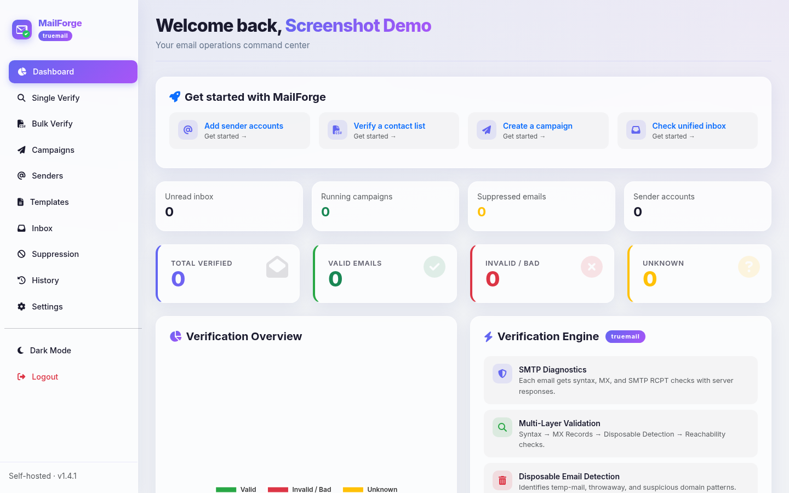
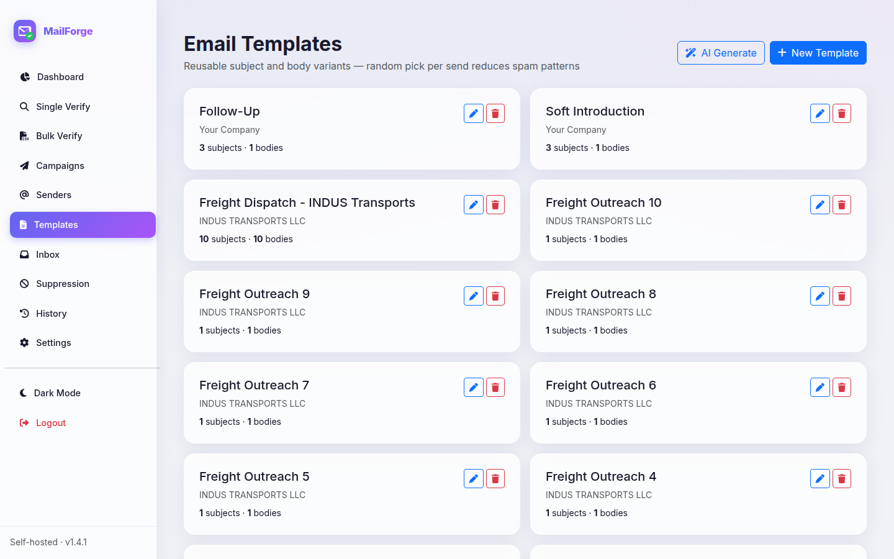

<div align="center">

# MailForge

Self-hosted email desk: verify a list over SMTP, send from your own accounts, and read every reply in one inbox.

<p>
  <a href="LICENSE"></a>
  <a href="package.json"></a>
  <a href="https://nodejs.org/"></a>
  <a href="https://github.com/mafzalkalwardev/mailforge/actions/workflows/ci.yml"></a>
  <a href="docker-compose.full.yml"></a>
</p>

</div>



## Start

```bash
docker compose -f docker-compose.full.yml up -d --build
```

Open **http://localhost:5000** and register. That command starts MongoDB and the web app. The compose file points the app at that MongoDB service and sets `INDUS_SKIP_LICENSE=1`, so a local stack starts without a license file. A Windows client install still expects `indus-license*.json`. See [client.md](client.md).

`docker compose up -d` starts the optional Reacher verifier from [`docker-compose.yml`](docker-compose.yml). Use the full compose file above for the app.

## Why this exists

MailForge is for keeping the list, the SMTP check, and the replies on a machine you run. You upload a CSV or spreadsheet, truemail-go talks to the recipient server, valid rows can become a campaign from accounts you add, and answers come back to one inbox. MongoDB on that same machine stores the data.

## What you can do

- Verify an address with syntax, MX, disposable and role checks, and a live SMTP RCPT dialog. truemail-go is the default. Set `VERIFIER_ENGINE=auto` to fall back to Reacher when the Go verifier is down.
- Run a bulk CSV or XLSX job, pause or resume it, and download rows before it finishes.
- Send a campaign through more than one account, with delays, warm-up fields, a suppression list, and an optional unsubscribe link.
- Start from the templates shipped in the repo, including 10 freight subjects and 10 bodies, or draft copy when a Groq, OpenRouter, or OpenAI key is set.
- Read and reply from the unified IMAP inbox. Sign-in uses JWT. The UI includes a dark theme.
- Check `GET /api/health` for version, database, and verifier status, and `GET /api/backup/export` for a JSON download of your data.

CSV imports detect comma, semicolon, or tab separators from the first row,
ignoring those characters inside quoted header cells. Email addresses can be
in any column; the original row cells are retained alongside verification results.



Install details, environment variables, and the Windows desktop installer are in [SETUP.md](SETUP.md) and [client.md](client.md).

From a source checkout: Node.js 18+, Go 1.22+, copy [`.env.example`](.env.example) to `.env`, set `JWT_SECRET` and `ENCRYPTION_KEY`, then `npm install` and `INDUS_SKIP_LICENSE=1 npm start`.

## Contributing

[CONTRIBUTING.md](CONTRIBUTING.md) is the fork, branch, and test flow. Run `npm test` before a pull request. Bug and feature forms are in [`.github/ISSUE_TEMPLATE/`](.github/ISSUE_TEMPLATE/).

| Path | What it is |
|------|------------|
| `server.js` | Express app on port 5000 |
| `public/` | Browser UI |
| `controllers/` and `routes/` | HTTP API |
| `backend/go/` | truemail-go SMTP verifier |
| `tests/` | `node --test` suite |

## License

MIT. See [LICENSE](LICENSE).

If this helped, a star helps others find it.
